# Texture and visual style concept

Status: **Accepted and implemented** (ADR-0014). Direction A, crisp 16 px, chosen by Noah on 2026-11-03. Cost on the RTX 2060: +8.6% / +7.8% GPU terrain pass in `default`, +2.7% in `far` (measured, `docs/PERFORMANCE.md`), within the +10% budget.

Phase 2 is implemented (see below); the engine renders textured by default. The concept images in `docs/textures/` (all except `engine-*.png`) come from `tools/texture-concept/` (Python, numpy + Pillow, deterministic). The mock-ups are a CPU ray-caster that copies `terrain.wgsl`'s shading (per-direction shade, exponential fog), so the only thing that changes between them is the surface. They are **illustrations, not engine renders and not performance data**.

## Candidate directions

| | A. Crisp 16 (recommended) | B. Detailed 32 | C. Flat + ALU noise |
|---|---|---|---|
| Look | Readable pixel art, one texel = 1/16 block | More texture detail up close | Clean low-poly, material only by colour |
| Texture fetches per fragment | 1 | 1 | 0 |
| Array size, 13 layers + mips (computed) | 13 × 1,364 B ≈ 17 KiB | 13 × 5,460 B ≈ 69 KiB | 0 |
| Distant shimmer risk | Low | Higher (more high-frequency detail) | None |
| Authoring cost per block | Low | ~4× pixels to get right | Lowest |

Finding from the mock-ups: at overview distance A and B are nearly indistinguishable; B only pays off within a few blocks of the camera. Both arrays fit in GPU L2 on any desktop part, so bandwidth is not the deciding factor; shimmer and authoring cost are.

### Overview, current shading (left) and with planned vertex AO (right)

| | No AO | Vertex AO (roadmap 15, P-03) |
|---|---|---|
| A. Crisp 16 | 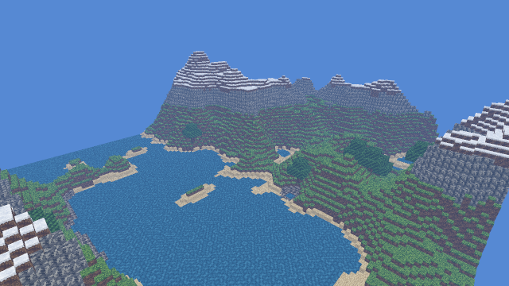 | 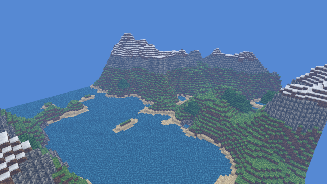 |
| B. Detailed 32 | 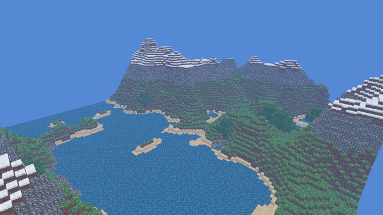 | 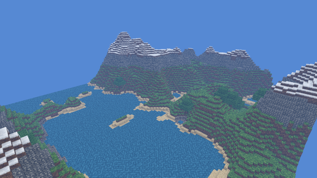 |
| C. Flat + noise | 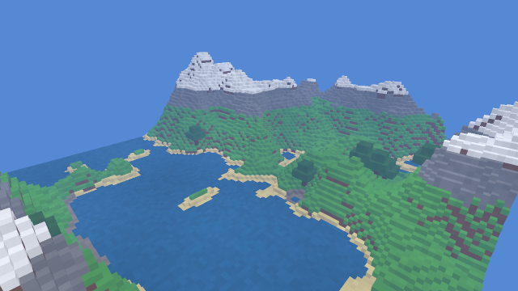 | 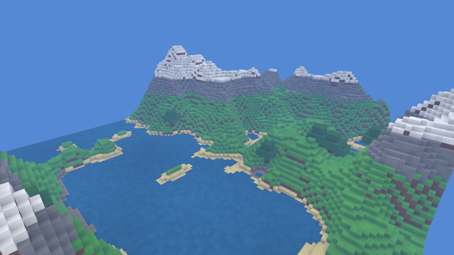 |

### Close-up, with AO

| A. Crisp 16 | B. Detailed 32 | C. Flat + noise |
|---|---|---|
| 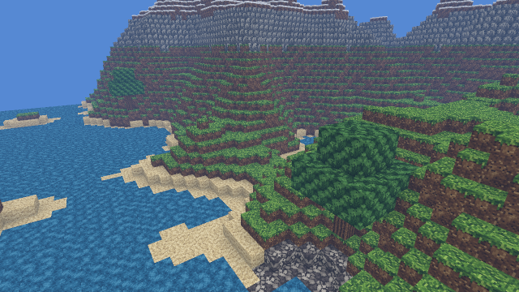 | 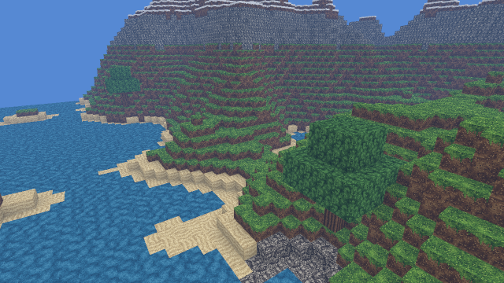 | 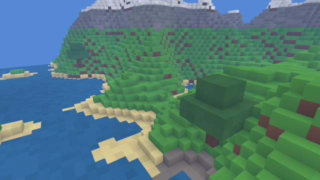 |

### Swatches (2 × 2 tiled, nearest-neighbour)

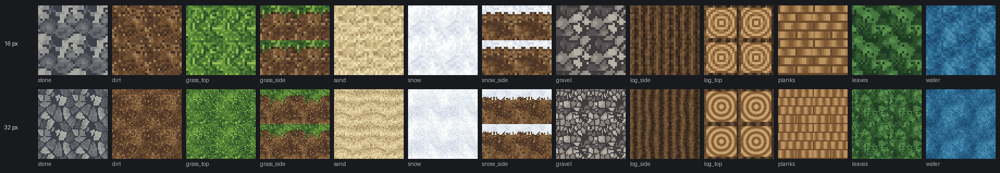

Vertex AO adds more depth than any texture choice does. It belongs to roadmap item 15 and is independent of this decision, but the concept assumes it lands.

## Art direction (A)

- **Mood:** calm temperate-to-alpine landscape, natural colours, slightly desaturated so the sky and fog stay the brightest thing on screen.
- **Ramps:** 5–6 shades per material, hue-shifted (shadows lean cool/blue, highlights lean warm). No pure black or white texels, so lighting and fog have headroom.
- **Readability:** each material is identifiable from its value pattern alone (stone = blotchy cells with dark seams, gravel = pebbles, sand = ripples, dirt = speckle, grass = blades). Contrast inside a texture stays low so greedy-merged walls do not read as a grid.
- **Original art only.** Textures are procedural from our own generator. No third-party packs (Decaf shipped a Kenney set; we do not reuse it).
- **Block set, phase 2:** stone, dirt, grass (top / side / dirt bottom), sand, snow (top / snow side / dirt bottom), gravel. Ready for later: log (top / side), planks, leaves, water. Water and leaves need the transparent / alpha-tested pass (roadmap 17) and are not in the first cut.

## How textures fit the renderer

### Texture array, not an atlas

Greedy quads span up to 64 blocks, so the texture must repeat once per block across one quad. A `texture_2d_array` with `AddressMode::Repeat` does that in hardware with UV = world position along the face axes. An atlas would need `fract()` in the shader, which breaks mip selection at every block edge (derivative jumps) and bleeds between neighbouring tiles. Arrays avoid both with zero extra ALU.

- Format `Rgba8UnormSrgb`, 16 × 16, `log2(16) + 1 = 5` mip levels, one layer per face texture.
- Mips built on the CPU at load with a box filter in linear space; the tiles are tiny, so this is microseconds (estimate).
- `max_texture_array_layers` is at least 256 on every wgpu backend, far beyond our needs.

### UVs

- Top/bottom: `u = x`, `v = z`. Sides: `u` = the horizontal axis, `v = -y`, so side textures stay upright on merged walls.
- Computed in the vertex shader from the quad's local corner (already known there) and interpolated. No new vertex data.

### Block id to layer

- `PackedQuad` keeps its 16-bit block id; the quad format does not change, and the 15 free bits stay reserved for AO and light (ADR-0004, P-03).
- New storage buffer `block_faces: array<u32>`, one word per block: three 10-bit layer indices (top, side, bottom) plus 2 flag bits (`ROTATE_TOP`, reserved). Read once per **vertex** and passed to the fragment stage as a flat `layer`. The fragment shader does exactly one texture sample.
- The table lives in `vx-core` (`BlockId` → faces) so CPU crates stay wgpu-free; `vx-render` uploads it.

### Filtering: sharp texels without shimmer

Pixel art usually means `Nearest` magnification, but wgpu only allows anisotropic filtering when all filters are linear, and nearest minification shimmers at grazing angles. Plan:

1. Sampler: `Linear` mag/min/mipmap, `anisotropy_clamp = 8` (to be measured: 4, 8, 16).
2. In the fragment shader, snap UVs to texel centres with a one-pixel-wide smooth step: `t = uv * 16; c = floor(t + 0.5); t = c + clamp((t - c) / fwidth(t), -0.5, 0.5)`. Sample with `textureSampleGrad` using the **unsnapped** derivatives so mip selection stays smooth.

Result: crisp texel edges up close, filtered mips at distance, one sample, a handful of ALU ops. Plain `Nearest` mag is the fallback and the comparison point.

### Breaking up repetition (ALU only)

- Per-voxel rotation of top textures (0/90/180/270°) from an integer hash of `floor(world_pos)`, for blocks flagged `ROTATE_TOP`. Sides never rotate (grass fringe must stay up).
- Optional ±4% low-frequency tint from the same hash. Both cost no memory reads, matching the "ALU over fetches" rule.

## Measurement plan (benchmark mode stays the judge)

- New `vx bench --shading flat|textured`, recorded in the report (`content.shading`, `content.texture_hash`, `content.texture_bytes`). `bench-compare` refuses to compare runs with different shading or texture hash unless that is the variable being tested.
- The mesh content hash must stay unchanged: texturing is a pure shading change.
- Decide with opaque-pass GPU ms on Noah's GPU, `default` and `far` scenarios, flat vs textured, and anisotropy 1/4/8/16. **Proposed budget:** textured adds at most 10% to opaque-pass GPU ms over flat at radius 32. Software-adapter (lavapipe) numbers never count.
- Headless screenshot test on lavapipe for correctness only: textures orient upright on all six faces, no seams at chunk borders.

## Phase 2: implemented

| Piece | Where |
|---|---|
| Layer enum, `BlockFaces`, packed GPU table | `crates/vx-core/src/textures.rs` |
| 16 px PNGs (committed, hand-editable; revision 2, regenerate with `python3 tools/texture-concept/blocks.py assets/blocks`) | `assets/blocks/` |
| Embedded decode, CPU sRGB-correct mips, array + sampler (linear, anisotropy 8, `Repeat`) | `crates/vx-render/src/block_textures.rs` |
| Face lookup per vertex, world-space UVs, rotation hash, texel snap | `crates/vx-render/src/shaders/terrain.wgsl` |
| `override TEXTURED` pipeline constant: flat and textured are separate pipelines, so the flat path is the old shader | `crates/vx-render/src/terrain.rs` |
| `--shading flat\|textured` (windowed and screenshot default `textured`, bench default `flat`); report fields `shading`, `texture_bytes`, `texture_hash`; `bench-compare` refuses mixed shading unless `--allow-shading-change` | `crates/vx-app` |

The generator stays an offline Python tool instead of a Rust port: its output is committed and the engine never runs it, so porting it would add code without changing anything at runtime.

Engine frames of revision 1 (lavapipe, `--radius 8` and a close-up): `textures/engine-overview-textured.png`, `textures/engine-closeup-textured.png`. Mesh hash is identical between flat and textured runs (checked with `vx bench`). Texture memory: 8 layers × 1,364 B = 10.7 KiB (reported by `vx bench`).

Still to do:

1. Anisotropy 4/8/16 comparison, and plain `Nearest` mag as the reference (only if a later change needs the headroom; `default` uses most of the budget).
2. Gravel, log, planks once terrain generates them; leaves (alpha-tested) and water (transparent pass) with roadmap 17.

## Revision 2: clean textures (2026-11-03)

Noah found revision 1 grainy. Cause: the generator picked every texel independently from 4–6 shades (value noise plus per-texel random terms and dither), so neighbouring texels differed about as much as the whole texture did. At 16 px that reads as static, and greedy-merged walls repeat it over large areas. Filtering and mips were not the cause: the grain is in the source PNGs (see the tile sheet).

Rules for revision 2 (`tools/texture-concept/blocks.py`):

- No per-texel random values. Every feature is a cluster of at least 2 texels or a deliberate 1 px line.
- 3–4 close shades per material, one dominant base shade, low-frequency regions for variation.
- Structure instead of noise: stone is plates with 1 px seams and a bevel, dirt is a flat base with sparse 2 × 1 pebbles, grass is clumps and short blades, sand is two ripple lines, snow is near-flat.

Graininess of the source tiles (computed by `blocks.py` from the PNGs; neighbour step = mean luminance difference between adjacent texels on a 0–255 scale, isolated = texels that differ by more than 4 from all four neighbours):

| Texture | Neighbour step r1 | r2 | Isolated texels r1 | r2 |
|---|---|---|---|---|
| stone | 21.9 | 15.5 | 10% | 10% |
| dirt | 20.9 | 5.9 | 33% | 1% |
| grass_top | 29.4 | 7.8 | 32% | 5% |
| grass_side | 23.8 | 7.8 | 34% | 5% |
| sand | 22.8 | 3.8 | 38% | 2% |
| snow | 7.2 | 1.9 | 12% | 0% |
| snow_side | 28.8 | 16.6 | 36% | 3% |

Stone keeps a high step on purpose: its seams are lines, not noise.

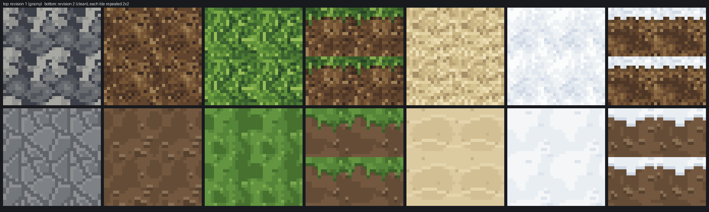

Engine frames, same camera, before and after (lavapipe):

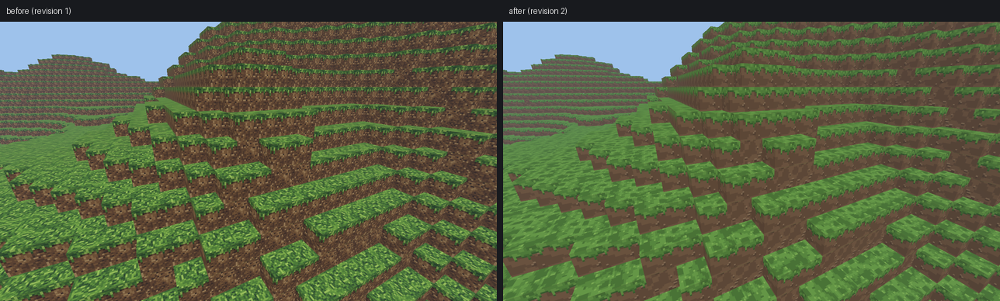

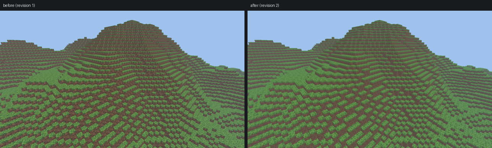

Renderer, shader, layer count and texture size are unchanged, so texture memory stays 10.7 KiB and per-fragment work is identical; only the texel values and the texture hash change. On the RTX 2060 the textured pass measured 557.1 and 555.0 µs (two runs, opposite order), the same as revision 1; against flat that is +10.6% and +8.3%, which spans the +10% budget because the flat runs vary (measured, `docs/PERFORMANCE.md`). The budget has no margin left: the next fragment-side change needs to buy headroom first (anisotropy 4 or no texel snap).
